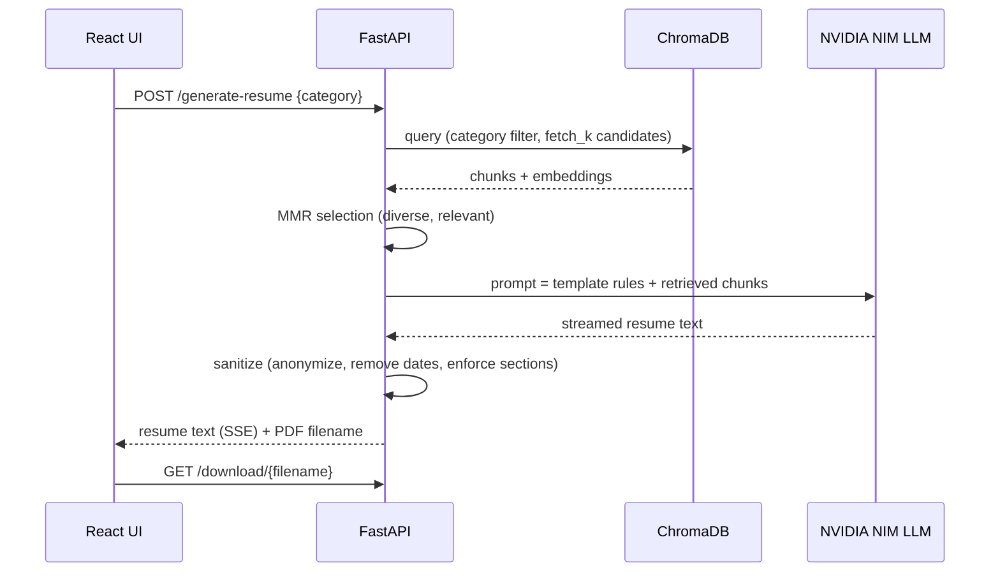

# How the Resume Generation RAG Works

This document walks through the pipeline stage by stage and explains the design decisions. Setup and API details are in [README.md](README.md).

## 1. What the system does

Given a job category (for example `INFORMATION-TECHNOLOGY` or `HEALTHCARE`), the app generates a **professional, anonymized resume** synthesized from real resume PDFs in that category. It is a Retrieval-Augmented Generation (RAG) system: instead of asking an LLM to invent a resume from nothing, it retrieves representative chunks of real resumes for the category and asks the LLM to write a new, composite resume grounded in them. Personal information is removed so the output cannot be traced to a real person.

## 2. Pipeline overview

## 3. Stage by stage

### 3.1 Ingestion (`backend/ingest.py`, `services/ingest_service.py`)

1. **PDF loading** (`pdf_loader.py`) extracts text from every resume in `data/data/<CATEGORY>/`.
2. **PII cleaning** (`pii_cleaner.py`) replaces emails, phone numbers and URLs with `[EMAIL]`, `[PHONE]`, `[URL]` placeholders before anything is embedded.
3. **Section-aware chunking** (`chunker.py`) splits resumes along their sections (skills, experience, education and so on) so each chunk is a coherent unit rather than an arbitrary slice.
4. **Embedding** (`embedding_service.py`) encodes chunks with `sentence-transformers/all-MiniLM-L6-v2`.
5. **Vector storage** (`vector_store.py`) upserts chunks and their category metadata into a ChromaDB collection (`resume_chunks`, cosine distance). PDFs are processed in parallel (`INGEST_PDF_WORKERS`), and the store can detect and repair a corrupt HNSW index (`INGEST_RESET_DB=true` forces a rebuild).

### 3.2 Retrieval (`services/retriever.py`)

The retriever asks ChromaDB for `RETRIEVAL_FETCH_K` candidates **filtered to the requested category**, then applies **Maximal Marginal Relevance (MMR)** to balance relevance and diversity, so the LLM sees varied examples rather than near-duplicates. A CrossEncoder reranker (`reranker.py`) is implemented but currently bypassed for speed; the top `RERANKER_TOP_N` MMR results are used.

### 3.3 Generation (`services/resume_generator.py`, `prompts/resume_prompt.py`)

The prompt carries the retrieved chunks and a fixed output template: header with a category designation only, then Professional Summary, Technical Skills, Work Experience, Projects, Education, Certifications and Achievements. The LLM (default `meta/llama-3.1-70b-instruct` through NVIDIA NIM's OpenAI-compatible API) is called at low temperature (default 0.2) for consistency, and its output is streamed to the browser with Server-Sent Events.

### 3.4 Sanitization (`services/resume_sanitizer.py`)

LLM output is never trusted to be anonymous. After generation, code strips emails, phones and URLs, removes dates, year ranges and "X years of experience" phrases, removes seniority labels from titles, replaces real organisations with placeholders (XYZ / ABC / DEF Company, XYZ University) and enforces the section order.

### 3.5 PDF export (`services/pdf_generator.py`)

The structured text is parsed into sections and rendered to PDF with ReportLab (WeasyPrint is used when available). Files are saved under `backend/generated_resumes/` and served by `/download/{filename}`.

## 4. Evaluation

The `backend/evaluation/` package measures quality without human labels. Each category gets four scores that are combined with fixed weights (retrieval 30%, category 25%, content 30%, privacy 15%):

- **Retrieval accuracy** — fraction of retrieved chunks whose category matches the request.
- **Category accuracy** — a BGE-embedding classifier checks whether the generated resume is closest to the requested category.
- **Content accuracy** — embedding similarity between the generated resume and the retrieved context.
- **Privacy accuracy** — regex-based detection of leaked emails, phones, URLs, addresses, real-looking names and real organisation names.

The saved report for all 24 categories (`evaluation/reports/report_all.json`) shows an overall average of 88.4% (retrieval 100.0%, category 100.0%, content 79.8%, privacy 81.2%). The package also contains grounding and template checks (`grounding_accuracy.py`, `template_accuracy.py`).

**Caveats.** The retrieval metric is high by construction because the query is already filtered by category. Content accuracy shows the resume is semantically close to its sources, not that it is good by a recruiter's standards. The privacy check is pattern-based and can miss or over-flag. Treat the figures as a regression signal for the pipeline, not as an external benchmark.

## 5. Design decisions and trade-offs

| Decision | Reason | Trade-off |
|---|---|---|
| Category-filtered retrieval | Keeps generated resumes on-topic | Cannot blend categories |
| MMR instead of plain top-k | Avoids near-duplicate context | Slightly more compute per request |
| Reranker bypassed | Faster first response | Possible loss of relevance precision |
| PII removed at ingest **and** after generation | Defence in depth; the LLM may still reproduce details | Regex rules can miss unusual formats |
| Different embedding model for evaluation | Avoids grading the retriever with its own model | Extra model download |
| ChromaDB baked into the Cloud Run image | Chroma's index files are unreliable on FUSE mounts | Rebuild and redeploy after re-ingesting |
| SSE streaming | Users see output immediately | Needs proxy configuration that does not buffer |

## 6. Frontend

A React + Vite app with a category selector, a Generate button with loading state, a live resume preview, PDF download, and an Accuracy dashboard that runs evaluations for one category or all 24 and displays cached reports.

## 7. Deployment

Local development uses `uvicorn` and `npm run dev`, or `docker-compose`. A Google Cloud Run path (separate `Dockerfile.gcp` files, Cloud Build config, Secret Manager for API keys, Cloud Storage mount for generated PDFs) is documented step by step in [`commands.md`](commands.md).

## 8. Limitations

- The dataset is not included, so the app cannot be reproduced end to end without your own resume PDFs.
- Output quality depends on the LLM and the dataset; there has been no human evaluation.
- Generated resumes are composite and anonymized by design: they carry no names, dates or real employers.
- Ingestion of the full dataset takes about 5–15 minutes on first run.
